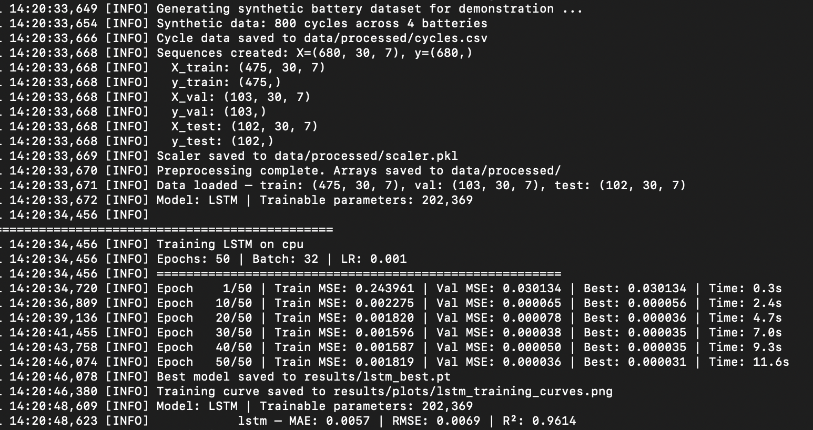
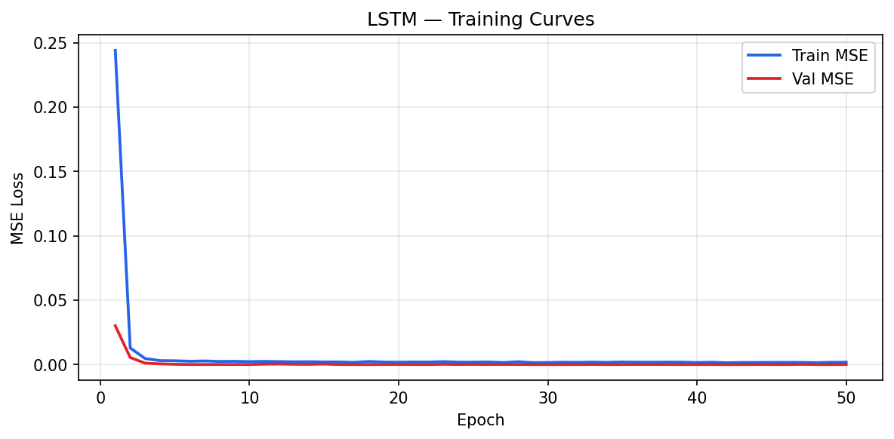
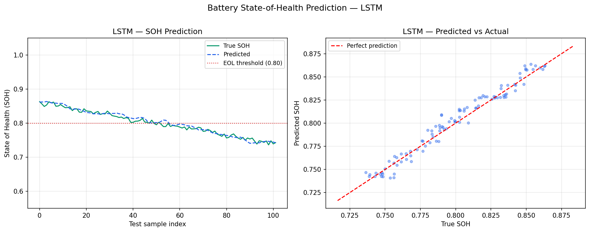

# Battery SOH Prediction — LSTM & RNN Models

Predictive modelling of battery **State of Health (SOH)** and degradation trajectories
using LSTM and RNN architectures on battery charge/discharge cycle data
(reported results: synthetic NASA-like dataset; the loader also supports the public NASA PCoE data).
Benchmarked against Random Forest and SVM baselines with a fully reproducible experiment pipeline.

---

> **📌 About this repo:** This is a showcase repo — write-up, architecture, and results only. The full implementation lives in a private core repo (kept private to protect the code and as a backup) and is available for a live walkthrough on request, e.g. in an interview.

---

## Project overview

Battery degradation prediction is critical for EV fleet management, stationary storage systems,
and industrial equipment. This project applies deep learning to predict SOH curves from
charge/discharge cycle data, enabling early detection of capacity fade.

**Domain context:** Motivated by battery-system analysis at Dan-Tech Energy GmbH (Berlin)
for partners including Salzgitter AG and E-Bikes Axess. This repo uses no company data.

---

## Models implemented

| Model | Architecture | Key hyperparameters |
|-------|-------------|-------------------|
| LSTM | 2-layer LSTM → Dense | hidden_size=128, dropout=0.2, seq_len=30 |
| RNN | Vanilla RNN → Dense | hidden_size=64, dropout=0.1 |
| GRU | 2-layer GRU → Dense | hidden_size=128, dropout=0.2 |
| Random Forest | Baseline | n_estimators=200, max_depth=10 |
| SVM | Baseline | kernel=rbf, C=1.0 |

---

## Results

> **Pipeline corrected (Oct 2026).** The first version used two inputs that encode the target
> (discharge capacity = SOH × 2 Ah, discharge time ≈ SOH × 3600 s) and predicted only one cycle
> ahead, which inflated R². Both inputs were removed and the model now predicts SOH **10 cycles
> ahead**, compared against a persistence baseline. Reproduce with `python src/data_loader.py`
> then `python src/train.py --model all`.

| Model | MAE | RMSE | R² |
|-------|-----|------|----|
| Persistence baseline ("SOH stays the same") | 0.0120 | 0.0136 | 0.837 |
| SVM (last-cycle features) | 0.0107 | 0.0134 | 0.842 |
| LSTM | 0.0073 | 0.0098 | 0.916 |
| RNN | 0.0064 | 0.0082 | 0.941 |
| GRU | 0.0051 | 0.0065 | 0.963 |
| **Random Forest** | **0.0042** | **0.0052** | **0.976** |

**Finding:** every sequence model beats the persistence baseline, but the Random Forest on the
flattened 30-cycle window is the best model here, and the GRU is the best sequence model. With
only 450 training windows of 5 smooth features, the 201k-parameter LSTM has little to gain from
modelling order explicitly. Sequence models should pay off with more cells, longer histories and
noisier real-world cycling, which is the next step with the NASA PCoE data. Single seed;
differences of a few thousandths in MAE are within run-to-run noise.

*Synthetic NASA-like dataset — 800 cycles across 4 cells, 5 features per cycle, 30-cycle windows,
10-cycle horizon → 644 sequences (450 train / 97 val / 97 test). The test set is the later life of
cell 4, which training never sees.*

### Training output



### Training curves



### SOH prediction vs actual



*Evaluated on the held-out test split of the synthetic dataset.*

**Key observations:**
- The persistence baseline is the bar to beat: a model has to predict the *change* in SOH, not repeat it
- The chronological split puts the later cycles of cell 4 in the test set, so training never saw that cell — but all 4 synthetic cells follow the same degradation law, so real cell-to-cell generalisation still needs leave-one-cell-out validation on NASA PCoE cells (B0005–B0018)
- Inputs are 5 per-cycle features: mean/min voltage, mean current, mean/max temperature

*Results on the held-out test set of the synthetic NASA-like dataset. The data loader also supports the public NASA PCoE Battery Dataset.*

---

## Project structure

```
battery-soh-lstm/
│
├── data/
│   ├── raw/                  # Raw cycle data (not included — see Data section)
│   └── processed/            # Preprocessed sequences
│
├── notebooks/
│   ├── 01_eda.ipynb          # Exploratory data analysis
│   ├── 02_preprocessing.ipynb
│   └── 03_model_training.ipynb
│
├── src/
│   ├── data_loader.py        # Data loading and sequence generation
│   ├── models.py             # LSTM, RNN, baseline model definitions
│   ├── train.py              # Training loop with early stopping
│   ├── evaluate.py           # Metrics and visualisation
│   └── utils.py              # Helper functions
│
├── results/
│   └── plots/                # Training curves, prediction plots
│
├── requirements.txt
└── README.md
```

---

## Data

The reported results use a synthetic NASA-like dataset generated by the pipeline.
For real data, the loader supports the **NASA Prognostics Center of Excellence (PCoE) Battery Dataset**
— a publicly available benchmark for battery degradation research.

Download: [https://www.nasa.gov/intelligent-systems-division/discovery-and-systems-health/pcoe/pcoe-data-set-repository/](https://www.nasa.gov/intelligent-systems-division/discovery-and-systems-health/pcoe/pcoe-data-set-repository/)


---

## Setup & usage

```bash
# Clone the repository
git clone https://github.com/PRATdoppelEK/battery-soh-lstm.git
cd battery-soh-lstm

# Install dependencies
pip install -r requirements.txt

# Run preprocessing
python src/data_loader.py

# Train models
python src/train.py --model lstm --epochs 50 --batch_size 32

# Evaluate
python src/evaluate.py --model lstm
```

---

## Requirements

```
torch>=2.0.0
numpy>=1.24.0
pandas>=2.0.0
scikit-learn>=1.3.0
matplotlib>=3.7.0
scipy>=1.10.0
jupyter>=1.0.0
```

---

## Key concepts

**SOH (State of Health):** Ratio of current capacity to rated capacity.
SOH = 1.0 at beginning of life, degrades toward 0.8 (end-of-life threshold).

**Sequence modelling:** Each training sample is a window of 30 charge/discharge cycles,
with the target being the SOH value 10 cycles after the window.

**Features (5 per cycle):** mean and min voltage, mean current, mean and max temperature.
Discharge capacity and discharge time are excluded because they encode SOH directly.

**Target:** SOH 10 cycles after the input window (`PREDICTION_HORIZON` in `src/data_loader.py`),
reported next to a persistence baseline.

---

## Author

**Prateek Gaur** — Applied ML Engineer | Battery Systems | TU Berlin M.Sc.
[LinkedIn](https://www.linkedin.com/in/prateek-gaur-15a629b4) · prateekgaur@gmx.de

---

## License

MIT License — free to use with attribution.
